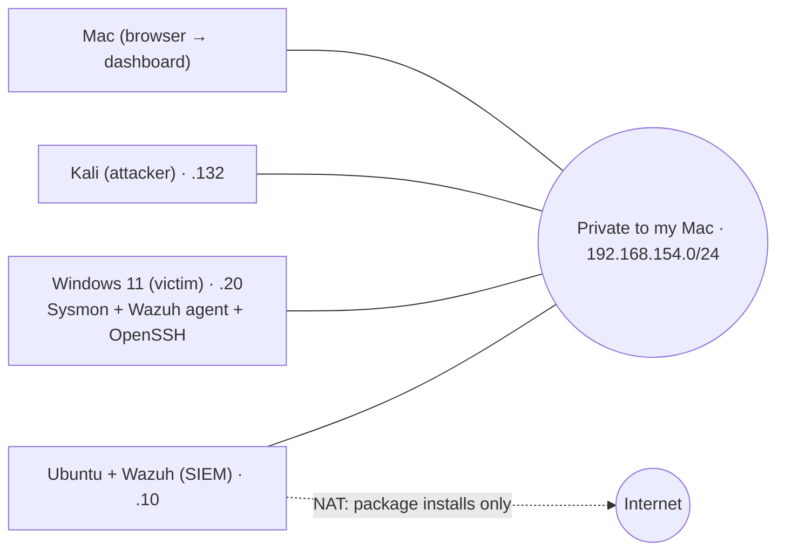

# SOC Home Lab

A self-built detection lab: a Wazuh SIEM, a Windows victim with Sysmon, and a Kali attacker, isolated on a host-only VMware Fusion network. I ran three attack techniques against the victim and used Wazuh to detect, triage, and in one case disprove a false positive.

Built while studying for a Postgraduate Diploma in Computing in Cybersecurity (ATU, Ireland) and preparing for SOC Analyst roles.

## Why

Reading about SOC tooling and actually running one are different skills. I wanted hands-on evidence I could point to: deploy a SIEM myself, generate real attack traffic, read the raw alerts, and tell the difference between a true positive and noise — the same triage judgment a SOC analyst exercises every shift.

## Environment

| VM | Role | OS | IP (lab network) |
|---|---|---|---|
| Ubuntu Server 24.04 ARM64 | SIEM — Wazuh 4.14.10 (indexer, manager, dashboard) | Linux | `192.168.154.10` |
| Windows 11 (ARM) | Victim — Sysmon + Wazuh agent + OpenSSH Server | Windows | `192.168.154.20` |
| Kali Linux (ARM64) | Attacker | Linux | `192.168.154.132` (DHCP) |

Network: VMware Fusion's built-in host-only network (`Private to my Mac`, `192.168.154.0/24`), isolated from the internet and from my home network. Only the Wazuh VM carries a second, NAT-connected adapter, used solely to install packages and updates — never to reach the attacker or the victim.



## A deliberate deviation from the plan: RDP → SSH

The original plan targeted RDP for the brute-force exercise. **Windows 11 Home does not accept inbound RDP connections** — that Remote Desktop server component only ships with Pro/Enterprise/Education. Rather than upgrade the edition, I substituted **SSH** (OpenSSH Server) as the target service. Same MITRE technique (`T1110` Brute Force), same detection goal, no licensing workaround needed.

I also discovered that the victim's Windows account was a Microsoft Account (sign-in via PIN), and OpenSSH on Windows authenticates through the `LogonUser` Win32 API — which **does not support Microsoft/cloud accounts**, only local or domain accounts. No password would have worked against that account over SSH, PIN or otherwise. I created a dedicated **local** account for the exercise instead of touching real credentials, which is the same separation of test and production credentials a real engagement would require.

## Exercises

### 1 · Network reconnaissance — `T1046` Network Service Discovery

```
sudo nmap -sT -Pn -n -sV -T4 -p 21,22,23,80,135,139,443,445,3389,5985,5986 192.168.154.20
```

Result: port 22 (SSH) open, everything else filtered by the Windows firewall.

**Troubleshooting note:** my first scan attempts hung indefinitely at 99% CPU. `--packet-trace` showed nmap was stuck attempting reverse-DNS resolution against the lab network's non-existent DNS server (`192.168.154.1:53`, `Connection refused`), and never recovered — even nmap's own `--host-timeout` didn't catch it. Adding `-n` (disable DNS resolution) fixed it: the same scan completed in 0.02 seconds. Full write-up: [`writeups/01-nmap-recon.md`](writeups/01-nmap-recon.md).

### 2 · Brute force against SSH — `T1110` Brute Force

```
hydra -l labvictim -P lista-corta.txt ssh://192.168.154.20
```

Result: valid credentials found in 1 second (`labvictim` / known test password). Detected in Wazuh as a repeating `Logon Failure → Windows Logon Success → Windows User Logoff` pattern in the Windows Security event log — SSH itself isn't a configured log source on the agent, but the OS still records every authentication attempt as a standard Windows security event, so detection worked without extra configuration. Full write-up: [`writeups/02-ssh-bruteforce.md`](writeups/02-ssh-bruteforce.md).

### 3 · Encoded PowerShell — `T1059.001` PowerShell

```
powershell -EncodedCommand dwBoAG8AYQBtAGkA
```

(decodes to `whoami`, harmless — the point is the encoding pattern itself, a common way to obscure a command from casual log review.)

Result: detected immediately — `Powershell.exe spawned a powershell process which executed a base64 encoded command` (Sysmon + Wazuh). A second, higher-severity alert also fired: `Executable file dropped in folder commonly used by malware` (level 15, the highest of the lab). I investigated the raw event instead of taking the alert at face value, and traced it to `__PSScriptPolicyTest_*.ps1` — a file Windows PowerShell creates internally on every launch as part of its own script-execution-policy check, not an artifact of the encoded command. **False positive, with root cause identified.** Full write-up, including the detection-tuning suggestion I'd propose: [`writeups/03-powershell-encoded.md`](writeups/03-powershell-encoded.md).

## What I'd do differently

- Configure the Wazuh agent to read the OpenSSH server's own log, not just the Windows Security event log, so SSH-specific detail (source port, client banner) isn't lost.
- Tune rule `92213` to exclude the `__PSScriptPolicyTest_*` filename pattern, closing the false positive at the source instead of relying on an analyst to catch it every time.
- Extend the lab to Microsoft Sentinel via Azure Arc, to compare detection coverage and KQL-based alerting against the same attack on a second SIEM.

## Stack

VMware Fusion · Wazuh 4.14.10 · Sysmon (SwiftOnSecurity config) · Kali Linux · Hydra · Nmap

## Reports

- [`writeups/01-nmap-recon.md`](writeups/01-nmap-recon.md)
- [`writeups/02-ssh-bruteforce.md`](writeups/02-ssh-bruteforce.md)
- [`writeups/03-powershell-encoded.md`](writeups/03-powershell-encoded.md)
